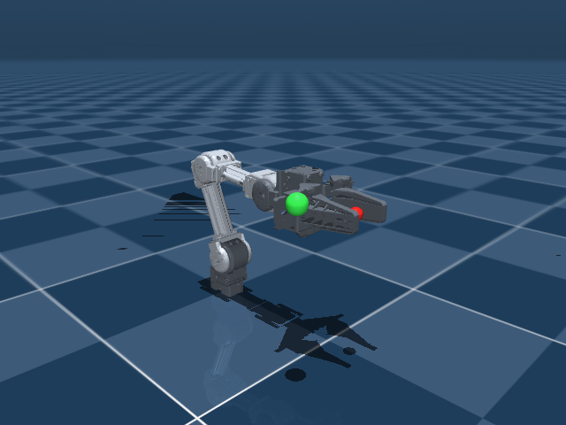

# OpenMANIPULATOR-X 四自由度仿真

基于 [ROBOTIS 官方 OpenMANIPULATOR-X MuJoCo 模型](https://github.com/ROBOTIS-GIT/open_manipulator/tree/main/open_manipulator_description/mujoco/open_manipulator_x)。
结构为底部 yaw + 肩部 pitch + 肘部 pitch + 腕部 pitch。固定夹爪开合，仅保留四个运动关节。



## 启动

```bash
python3 -m pip install 'mujoco>=3.3' numpy pin
python3 demo/IK/4dof/run.py
```

不使用 ROS 或 launch，没有 CLI 参数。网格已经保存在本目录，启动无需下载模型。
`run.py` 中的 `TARGET_POSITION` 为世界系目标位置（m），`TARGET_PITCH` 为目标 ZYX Pitch（rad）。红点是末端，绿球是目标；也可以在窗口中选中绿球并按住 Ctrl + 鼠标右键拖动。

## 控制接口

与 7dof demo 一样，在 `controller.py` 中实现：

```python
compute(q, dq, ee_position, target_position, dt)
```

- q、dq 为形状 `(4,)` 的 NumPy 数组，单位分别为 rad 和 rad/s。
- 末端与目标位置是形状 `(3,)` 的世界系坐标，单位 m。
- 返回四个目标关节角；返回 None 则保持上一条命令。
- 控制周期 0.01 s，MuJoCo 物理步长 0.002 s。

`compute()` 保留单个迭代循环，计算四维误差 `[位置误差, Pitch 误差]`，使用 `J_task = A @ J` 求关节增量。
`A` 的位置部分为 `[I, -skew(p)]`；Pinocchio WORLD 角速度对应的 Pitch 行为 `[-sin(yaw), cos(yaw), 0]`。
每次迭代重新计算当前 `q_target` 的 FK 与雅可比，再用伪逆更新。Pitch 接近 ±90° 时欧拉角参数化奇异，应避开。
这是简单的局部迭代，不保证任意初值或不可达目标收敛。

## q 与模型定义

MuJoCo 和 Pinocchio 使用同一个 `arm.xml`，固定基座，无关节映射、重排或角度偏移：

```python
q = np.array([q1, q2, q3, q4])  # joint1 到 joint4，单位 rad
```

两边均为 `nq = nv = 4`，MuJoCo 有四个位置执行器。关节目标按模型中的各关节限位截断。
零位的轴方向和轴上点在世界系中为：

| 关节 | 运动 | 轴方向 | 轴上点（m） |
|---|---|---|---|
| joint1 | 底部 yaw | +z | [0.012, 0, 0] |
| joint2 | 肩部 pitch | +y | [0.012, 0, 0.0595] |
| joint3 | 肘部 pitch | +y | [0.036, 0, 0.1875] |
| joint4 | 腕部 pitch | +y | [0.160, 0, 0.1875] |

末端 `ee` 位于原模型的 end_effector_link，零位世界位置为 `[0.286, 0, 0.1875]`，朝向为单位旋转。
`ArmSimulation.fk(q)` 提供 MuJoCo 参考 FK，返回 4×4 位姿，不会修改正在运行的仿真状态。

模型沿用官方尺寸、惯性和关节轴。为了方便练习，加入理想重力补偿并关闭接触，夹爪固定在原模型零开合位置。
来源、提交版本和修改记录见 `models/open_manipulator_x/SOURCE.md`，许可证为 Apache-2.0。
