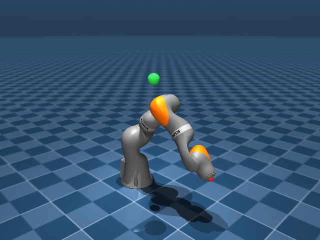

# KUKA iiwa 14 七自由度位置控制练习

```bash
python3 -m pip install mujoco numpy pin
python3 demo/IK/run.py
```

采用 Google DeepMind 官方维护的 [MuJoCo Menagerie KUKA iiwa 14 模型](https://github.com/google-deepmind/mujoco_menagerie/tree/main/kuka_iiwa_14)，包含完整橙灰色外观网格。模型及许可证已随 demo 保存，启动时无需联网。



固定基座、七个转动关节，MuJoCo 位置执行器接收七个目标关节角。
红点是末端，绿球是世界系目标位置。在 `run.py` 修改 `TARGET_POSITION`；也可以在窗口中双击选中绿球，按住 Ctrl 并用鼠标右键拖动。
关闭窗口或按 Ctrl+C 退出。启动脚本没有 CLI 参数。

## 自己实现控制

在 `controller.py` 的 `Controller.compute(q, dq, ee_position, target_position, dt)` 中写算法。
返回形状 `(7,)` 的目标关节角（rad）；默认返回 `None`，继续保持上一条命令。
初始命令为模型的 home 姿态，因此留空时机械臂不会自动追踪目标。
控制周期为 0.01 s，物理步长为 0.002 s。练习只控制末端位置，不限制朝向。

`self.model`、`self.data` 和 `self.ee_id` 已提供，供你直接调用 Pinocchio。
没有加入雅可比求逆、误差迭代或冗余控制算法。

## q 的定义

MuJoCo 和 Pinocchio 读取同一份 `arm.xml`，都采用固定基座。
七个关节都是有界 hinge，每个关节只占一个配置元素：

```python
q = [q1, q2, q3, q4, q5, q6, q7]  # rad
```

顺序为 `joint1` 到 `joint7`，两边均为 `nq = nv = 7`。
MuJoCo 的 `data.qpos` 可以直接传给 Pinocchio，不需要索引映射、零位偏移或角度表示转换。
模型的 q=0 是沿 +z 竖直伸展；启动用的 home 是一组非零关节角，不会改变 q 的定义。

## 模型与核对接口

所有关节轴在 XML 中以各自 body 的局部坐标表达。KUKA 模型的 body 含固定旋转，局部轴不能直接当成世界轴；以下是 q=0 时的世界系表达：

| 关节 | 轴方向 | 零位世界系轴上点（m） |
|---|---|---|
| joint1 | +z | [0, 0, 0.1575] |
| joint2 | +y | [0, 0, 0.3600] |
| joint3 | +z | [0, 0, 0.5645] |
| joint4 | -y | [0, 0, 0.7800] |
| joint5 | +z | [0, 0, 0.9645] |
| joint6 | +y | [0, 0, 1.1800] |
| joint7 | +z | [0, 0, 1.2610] |

末端是 `ee` site，零位位于 `[0, 0, 1.306]`，朝向为单位旋转。
`ArmSimulation.fk(q)` 返回 MuJoCo 算出的世界系末端 4×4 位姿，可核对自己实现的 FK，不会修改仿真状态。

模型采用理想重力补偿，并关闭碰撞，便于先练习位置控制。关节目标按 KUKA 模型各关节的 `jnt_range` 限幅，七个关节的范围并不完全相同。上游来源与适配记录见 `models/kuka_iiwa_14/SOURCE.md`。

