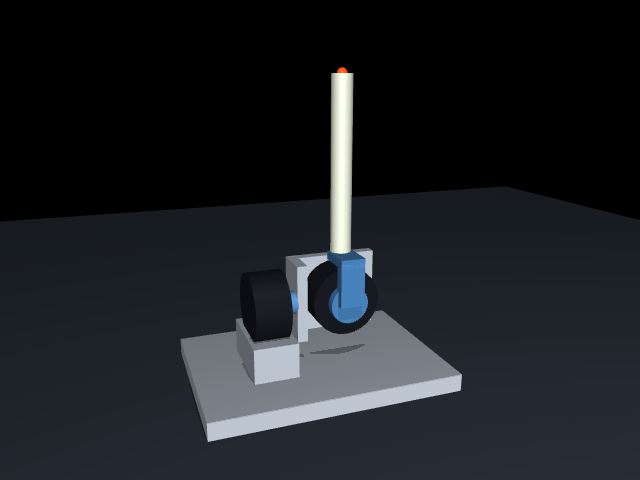

# 灵足 01 双轴力反馈摇杆仿真

参考用户补充的结构图：左侧第一电机固定在底座上，输出轴直接连接安装件；安装件直接固定中间第二电机，第二电机的输出法兰通过折弯连接座连接上方摇杆。第一轴沿基座 X 方向，第二轴沿随第一轴转动的局部 Y 方向。零位时，第一电机输出轴、中间电机中心和竖直摇杆中心线均在 **Y=0 的 XZ 平面**内。

第二电机中心设在第一电机输出轴线上，两轴相交，距地面 0.09 m；握持点距两轴交点 **0.25 m**。连接座升高 0.055 m，杆身从轴心上方 0.055 m 延伸到 0.25 m，实际杆长 0.195 m。杆身总质量仍为 0.5 kg。两个自由度均为 ±30°。尺寸和惯量为估算，并非按照片标定的 CAD 模型。



## 运行

安装依赖 `mujoco numpy scipy` 后，在仓库根目录执行：

```bash
python3 demo/forceback/run.py
python3 demo/forceback/run.py --headless --seconds 5
python3 demo/forceback/run.py --mode gravity  # 仅重力补偿
python3 demo/forceback/run.py --mode torque   # 手动力矩，初始为零
```

脚本也支持从任意目录通过绝对路径启动。默认运行双轴阻抗与重力补偿，目标为竖直零位。可在 `run.py` 的 `Controller(...)` 构造处设置目标角、刚度与阻尼。默认末端刚度为 80 N/m，阻尼为 32 N·s/m，目标为两轴零位。可以用查看器的鼠标扰动交互（选中物体后 Ctrl + 鼠标右键拖动施加力），松开后摇杆返回目标。`--mode torque` 模式允许在查看器 Control 面板手动调整力矩；其他模式每步更新力矩。

零力矩不保持竖直：连接件和输出连接座的侧向质心偏移在零位产生约 0.0228 N·m 的第一轴重力项；竖直摇杆也是不稳定平衡，受到扰动后会倾倒至机械限位。第二电机中心现位于第一轴线上，已取消旧模型中该电机 65 mm 侧偏引入的重力矩。限位为 MuJoCo 软约束，动态下允许少量越界。模型仅用关节限位约束行程，关闭所有几何接触以避免简化支架之间发生虚假碰撞。

## 电机与质量分配

电机依据 [灵足 RobStride 01 官方产品页](https://robstride.com/products/robStride01)：单台质量 **0.38 kg**，外形 78.5 × 78.5 × 40 mm，减速比 **7.75:1**，峰值输出力矩 **17 N·m**。外形和壳体惯量使用半径 39.25 mm、轴向长度 40 mm 的均匀实心圆柱近似，实际惯量需要 CAD 或辨识替换。

| 刚体 | 质量 kg | 质心（相对父体，m） | 随动关系 |
| --- | ---: | --- | --- |
| `motor_x_housing` | 0.38 | (-0.09, 0, 0) | 固定在底座，不计入运动关节负载 |
| `motor_mount` | 0.18 | (-0.025, 0.020, 0) | 随第一轴，等效 0.10 × 0.04 × 0.09 m 均匀长方体 |
| `motor_y_housing` | 0.38 | (0, 0, 0) | 随第一轴转动，电机质量及壳体惯量计入第一轴负载 |
| `inner_hub` | 0.08 | (0, -0.016, 0.028) | 随两轴，法兰及折弯连接座，等效 0.04 × 0.04 × 0.06 m 长方体 |
| `stick` | **0.50** | (0, 0, 0.1525) | 随两轴，杆长 0.195 m、半径 0.012 m 均匀圆柱；握持力臂 0.25 m |

`stick` 的 0.5 kg 是整个新增摇杆总质量，包含握持部分，没有额外叠加握把质量，也没有将其当作集中在 25 cm 末端的点质量。握持点为 `grip` site，表示力作用位置；人的手部质量未加入。运动部件合计 **1.14 kg**；两台电机及运动结构共 **1.52 kg**，底座固定且未标定质量。

## 惯量矩阵

下表给出各刚体**质心处、刚体局部坐标系**的惯量矩阵对角元，单位 kg·m²；非对角元全部为零。XML 使用显式 `inertial`，几何外观不重复计算质量。

| 刚体 | Ixx | Iyy | Izz |
| --- | ---: | ---: | ---: |
| X 电机壳体 | 0.000292706875 | 0.000197020104167 | 0.000197020104167 |
| 电机安装件 | 0.0001455 | 0.0002715 | 0.000174 |
| Y 电机壳体 | 0.000197020104167 | 0.000292706875 | 0.000197020104167 |
| 输出法兰 / 折弯连接座 | 0.0000346666666667 | 0.0000346666666667 | 0.0000213333333333 |
| 摇杆 | 0.001602375 | 0.001602375 | 0.000036 |

均匀圆柱：轴向惯量 `m*r²/2`，横向惯量 `m*(3*r²+L²)/12`；长方体：`Ixx=m*(b²+c²)/12`，其余循环。MuJoCo 根据刚体层级和质心位置自动施加平行轴定理。零位的两关节等效惯量矩阵约为 `diag(0.0137628868, 0.0133278867)` kg·m²；运动后应通过 MuJoCo 计算完整、随姿态变化的质量矩阵。

电机全部质量暂等效为安装壳体的刚体质量，未拆分转子 / 输出盘，也未添加未经辨识的反射转子惯量（`armature=0`）。因此尚不模拟齿轮弹性、齿隙、转矩带宽、转速包络或热限制。关节粘性阻尼暂取 0.03 N·m·s/rad，库仑摩擦暂取 0.01 N·m，都是估算参数。

## 力矩接口

`simulation.py` 提供 `JoystickSimulation`，输入顺序为 `[stick_x, stick_y]`：

```python
from simulation import JoystickSimulation  # 在本目录运行，或将本目录加入 sys.path

sim = JoystickSimulation()
sim.set_torque([0.2, -0.1])  # 减速器输出端关节力矩，N·m
sim.step()                  # 推进 1 ms
print(sim.state())          # 角度、角速度、执行器力矩及握持点世界坐标
```

MuJoCo 使用两个 `<motor gear="1">`，`data.ctrl` 直接对应输出端 N·m，不再乘 7.75 的减速比；Python 接口和 XML 均设置 ±17 N·m 限幅。峰值仅作仿真幅值上限，不表示真实电机可持续输出。`state()` 的力矩是执行器输出，不是用户手力；若以后需要模拟手部外力，应在 `grip` 位置施加世界系外力，例如用 `mujoco.mj_applyFT` 转换为广义力后写入 `data.qfrc_applied`，每步按需求更新或清零。

## 运动学与动力学辅助函数

`control.py` 用 NumPy 直接实现二维解析公式及双轴阻抗控制。`q=[q1,q2]` 对应两台电机的输出角，单位 rad。两轴正交，所以虽然只有两个关节，握持点仍用三维世界坐标表示。

- `fk(q)`：返回握持点 `[x,y,z]`。
- `jacobian(q)`：返回 3×2 位置雅可比，`v=J@dq`，速度在世界系表达。
- `mass_matrix(q)`：2×2 惯性矩阵 `M`。
- `coriolis_vector(q,dq)`：直接返回速度相关力矩 `c=C@dq`。
- `gravity_vector(q)`：重力补偿力矩 `g`。
- `friction_torque(dq)`：阻尼和滑动摩擦力矩 `f`。

正运动学直接为：

```text
x = L*sin(q2)
y = -L*sin(q1)*cos(q2)
z = H + L*cos(q1)*cos(q2)
L=0.25 m，H=0.09 m
```

在本目录运行：

```python
from control import fk, jacobian, mass_matrix, Controller

q, dq = [0.1, -0.2], [0.3, -0.4]
p = fk(q)
v = jacobian(q) @ dq
M = mass_matrix(q)
tau = Controller().update(q, dq)
```

质量和惯量已经合并成文件顶部的几个常数，对应当前 `joystick.xml`，修改模型时需同步更新。控制器不做力矩限幅，接入仿真时使用 `sim.set_torque(tau)`。辅助函数不求解机械限位或零速静摩擦；零速摩擦近似取零。

## 角度误差与两轴力臂

轴一根据当前姿态取有效力臂 `r1=L*cos(q2)`，轴二使用固定力臂 `r2=L`。两轴都由角度误差计算末端位移和速度，得到末端弹簧阻尼力后，再换算为电机力矩：

```text
r = [L*cos(q2), L]
delta_q = q_target-q         # 角度误差，rad
s = r*delta_q                # 末端切向位移的局部近似，m
v = r*dq                    # 当前末端切向速度，m/s；dq 为角速度
F = K*s-D*v                 # 两轴末端力，N
tau = r*F+g(q)              # 关节力矩，N*m
```

所有乘法均为逐元素乘法。这里区分角度误差 `delta_q` 和角速度 `dq`；轴二的位移为 `L*delta_q2`，速度为 `L*dq2`。轴一随第二轴倾角修正运动半径，不取世界 X/Y 的投影，也不使用完整空间位姿误差。位移是在当前姿态下按力臂换算的局部近似。

K 的单位为 N/m，D 的单位为 N·s/m，可以是标量或两个轴各自的参数。默认 `K=80,D=32`，在零位时等效角刚度 `K*L²=5 N·m/rad`、角阻尼 `D*L²=2 N·m·s/rad`，与前一版角度控制在零位附近一致。

```python
from control import Controller

controller = Controller(q_target=[0, 0], stiffness=80, damping=32)
F = controller.impedance_force(q, dq)  # 可读取两轴末端力，N
tau = controller.update(q, dq)
sim.set_torque(tau)                    # 最终限幅至 ±17 N·m
```

`main()` 直接调用 `update(q,dq)`。控制器保留重力补偿，不补偿科氏力和摩擦。设置刚度、阻尼均为零时，仅输出重力补偿。FK、雅可比和动力学公式保留为独立辅助函数。

## 验证

仓库根目录执行：

```bash
python3 -m unittest discover -s tests -p 'test_forceback*.py' -v
```

覆盖两自由度质量矩阵、零位共面关系、电机壳体随动姿态、25 cm 握持距离、力矩映射与限幅、扰动下的仿真稳定性。解析辅助函数通过 MuJoCo 的末端位置、位置雅可比、质量矩阵和速度偏置交叉验证；控制器验证力臂与末端雅可比的一致性、两轴恢复力矩方向、阻尼耗能，以及受扰动后返回非零目标姿态。
